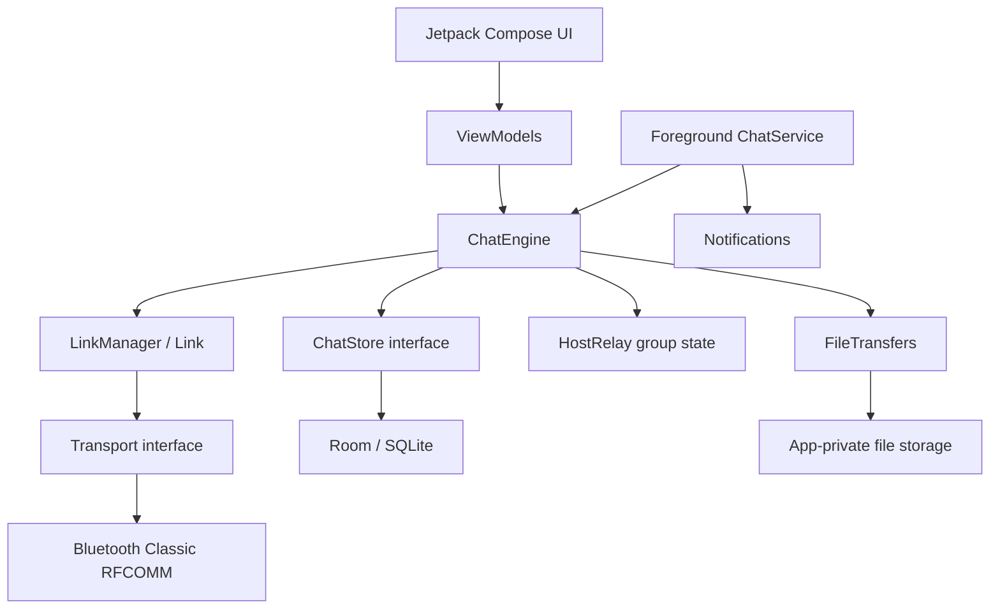

# Architecture

OfflineChat is a native Android application built with Kotlin and Jetpack Compose. The messaging engine is separated from Android UI and Bluetooth implementation so most protocol and relay behaviour can be tested on the JVM.

## High-level components



## Source packages

| Package | Responsibility |
|---|---|
| `core/` | Versioned packet format, payload codecs, chunk reassembly, host relay state and host election rules. Mostly platform-independent Kotlin. |
| `domain/` | Conversation/message models and interfaces such as transport, storage, identity, and engine settings. |
| `net/` | Peer link lifecycle, HELLO handshake, deduplication of links, keep-alives, control/bulk write queues. |
| `engine/` | Direct chat, group lifecycle, host-relayed group delivery, retry/failover, file transfer coordination. |
| `bluetooth/` | Bluetooth adapter and runtime permission state, Classic device discovery, probe handshake, RFCOMM sockets. |
| `data/` | Room entities/DAO, persistent chat store, SharedPreferences settings/identity, file import and optional image shrinking. |
| `service/` | Connected-device foreground service, service lifecycle and notifications. |
| `di/` | Hilt bindings and application-level dependency injection. |
| `ui/` | Compose screens, navigation, view models, reusable components and theme. |

## Direct message flow

1. A phone discovers a Bluetooth device using Android Bluetooth Classic discovery.
2. The discovery manager probes the device using the app's lightweight HELLO handshake.
3. The connecting device opens an RFCOMM socket using the selected secure or insecure service UUID.
4. The peers exchange HELLO packets and establish a single logical link per peer pair.
5. The sender stores a local outgoing message and sends a TEXT packet.
6. The receiver stores the message and responds with an ACK.
7. The sender updates the delivery state. Pending messages are retried after a link reconnects.

## Group topology

Groups use a host-centred star topology:

```text
             Member B
                |
Member C --- Group Host --- Member D
                |
             Member E
```

Each member maintains a link to the host; members do not form a full mesh with one another. The host assigns monotonically increasing sequence numbers to group text messages and forwards them to online members. A fixed candidate ordering is used for host migration/election. A network partition can prevent all members from agreeing on the same host.

## File transfer flow

- The sender sends file metadata, including name, MIME type, size, chunk count, and SHA-256 digest.
- The receiver accepts or rejects the transfer.
- The sender streams chunks over the link. Each chunk includes a CRC-32 check.
- The receiver writes chunks to a partial file and verifies the final SHA-256 digest.
- Direct transfers can request the next missing chunk when resuming an existing partial file. Group transfer handling is different and does not use that same resume path.
- Text and control packets have priority over file chunks, and the bulk queue applies backpressure.

Current limits are 10 MB per direct transfer and 5 MB per group transfer. See [../PROTOCOL.md](../PROTOCOL.md) for exact packet fields and compatibility rules.

## Persistence

Room stores conversations, messages, and group membership. Preferences store the local random peer ID, display name, and user settings. Files are staged in app-private storage and received files are stored in the app-specific received-files directory.

**Development caveat:** the Room database currently uses destructive migration fallback. When the schema changes, existing chat history can be cleared. Real migrations must be implemented before a public release.

## Background execution

`ChatService` is a connected-device foreground service that starts/keeps the engine active and displays notifications. Android may still stop or restrict work due to permission changes, force-stop, manufacturer battery management, or platform lifecycle rules. Background reliability must be verified on target devices and Android versions.

## Transport scope

The current production transport implementation is Bluetooth Classic RFCOMM. BLE advertising/scanning, Wi-Fi Direct, and LoRa are not implemented. Group relay is not a general-purpose multi-hop mesh. See [ROADMAP.md](ROADMAP.md).
